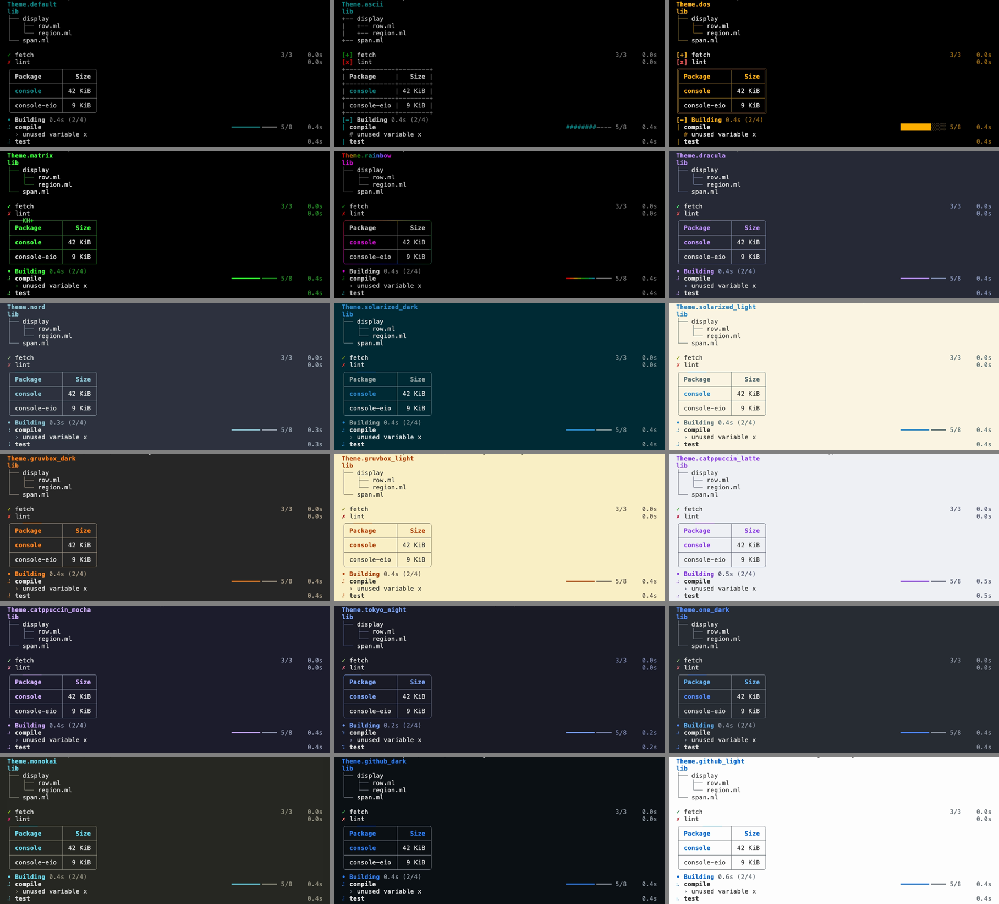
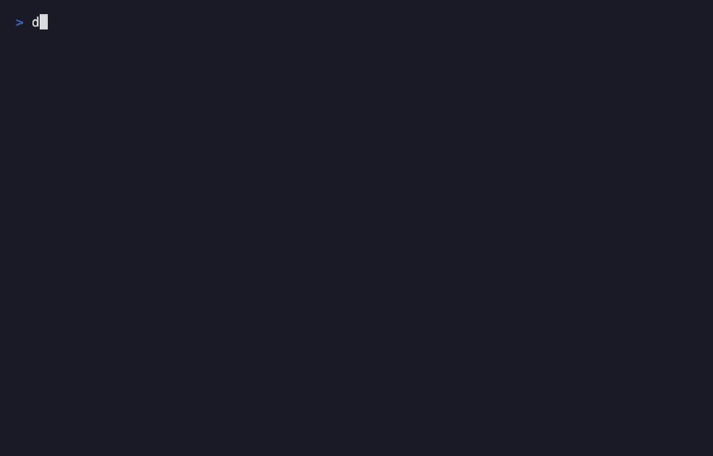

# console

Colours, tables, trees and progress rows for OCaml command-line tools.

console prints into your terminal's normal scrollback, like Rich or
indicatif, and redraws only its progress rows; for programs that take over
the whole screen, use [notty](https://github.com/pqwy/notty) or
[lambda-term](https://github.com/ocaml-community/lambda-term). Windows
consoles are not supported.

This program runs three test suites side by side as progress rows, then
prints their results in a table. Its `--theme` option picks one of eighteen
themes and its `--color` option says when to use colour:

<!-- $MDX file=examples/quickstart/main.ml,part=main -->
```ocaml
open Console

let suites = [ ("parser", 120); ("layout", 80); ("render", 60) ]

let test clock display (name, total) =
  Display.with_task display name @@ fun task ->
  for cur = 1 to total do
    Display.set_count task ~cur ~total;
    Eio.Time.Mono.sleep clock 0.02
  done

let main color theme =
  Console_tty.setup ?style_renderer:color ~theme ();
  Eio_main.run @@ fun env ->
  let clock = Eio.Stdenv.mono_clock env in
  Console_eio.run ~clock ~header:"Testing" (fun d ->
      Eio.Fiber.List.iter (test clock d) suites);
  let ok = Span.role `Ok "passed" in
  let row (name, n) = [ Span.text name; Span.text (Int.to_string n); ok ] in
  let cols =
    Table.
      [
        column (Span.text "Suite");
        column ~align:`Right (Span.text "Tests");
        column (Span.text "Result");
      ]
  in
  Fmt.pr "%a@." Table.pp (Table.v cols (List.map row suites))

let theme =
  Cmdliner.Arg.(value & opt (enum Theme.all) Theme.default & info [ "theme" ])

let cmd =
  Cmdliner.Cmd.(
    v (info "check")
      Cmdliner.Term.(const main $ Fmt_cli.style_renderer () $ theme))

let () = exit (Cmdliner.Cmd.eval cmd)
```


On a terminal the rows are redrawn in place and each suite leaves one line
when it ends. In a pipe or a CI log nothing is redrawn: the same program
prints plain lines, without colour unless `--color=always` asks for it. The
program is [examples/quickstart/main.ml](examples/quickstart/main.ml).

## Installation

<!-- $MDX skip -->
```sh
$ opam install console console-eio
```

Until console is in the opam repository, install it from GitHub:

<!-- $MDX skip -->
```sh
$ opam pin add https://github.com/samoht/ocaml-console.git
```

The `console` package holds the widgets, which need neither Eio nor Unix,
and three small libraries: `console.tty` decides on colour for the standard
outputs, `console.text` makes untrusted text safe to print and
`console.input` is a line editor. The `console-eio` package runs the
progress rows with [Eio](https://github.com/ocaml-multicore/eio). Each
module is documented in its `.mli` file, and the tutorial
[A first CLI](doc/eio/tutorial.mld) builds a command like the one above
step by step, with a test of its output.

## Styles, spans and tables

Styles combine with `+`, and text in a style is a `Span.t`, printed by a
[`Fmt`](https://erratique.ch/software/fmt) printer. `Console_tty.setup`, in
`console.tty`, turns colour on when the output is a terminal; without it
everything prints plain:

```ocaml
open Console

let success = Style.(bold + fg Color.green)
let error = Style.(bold + fg Color.red)

let () =
  Console_tty.setup ();
  Fmt.pr "%a@." Span.pp (Span.styled success "✓ Build passed");
  Fmt.pr "%a@." Span.pp (Span.styled error "✗ Tests failed")
```

`Style.styled` styles any `Fmt` printer, so a value keeps its own printer:

```ocaml
let () = Fmt.pr "%a tests passed@." Console.Style.(styled bold Fmt.int) 42
```

A span can hold several styles and links, which a terminal that supports
them opens on a click. `Span.pp` prints the colours and links when its
formatter is set to colour, and `Span.to_string` returns the plain text:

```ocaml
open Console

let docs =
  Span.(
    styled Style.bold "Read "
    ++ link ~style:Style.underline ~uri:"https://ocaml.org/docs" "the manual")

let () = Fmt.pr "%a@." Span.pp docs
```

The widgets take their text as spans. A table is as wide as its content
needs, unless you give it a `~width`:

```ocaml
open Console
open Span

let print_files () =
  let table = Table.(
    v ~border:Border.rounded
      [ column (text "Name"); column ~align:`Right (text "Size");
        column (text "Modified") ]
      [
        [ text "README.md"; text "2.4K"; text "2 hours ago" ];
        [ text "src/"; text "4.0K"; text "yesterday" ];
        [ text "Makefile"; text "892"; text "3 days ago" ];
      ]
  ) in
  Fmt.pr "%a@." Table.pp table
```

```ocaml
# print_files ();;
╭───────────┬──────┬─────────────╮
│ Name      │ Size │ Modified    │
├───────────┼──────┼─────────────┤
│ README.md │ 2.4K │ 2 hours ago │
│ src/      │ 4.0K │ yesterday   │
│ Makefile  │  892 │ 3 days ago  │
╰───────────┴──────┴─────────────╯
- : unit = ()
```

Widths are counted in terminal cells, so a column of Chinese, Japanese or
Korean text, or of emoji, which take two cells each, stays aligned.
`Border.simple` draws no frame, only a rule under the header, and
`Table.v ~rules:true` separates the rows, which helps when cells wrap:

```ocaml
# print_endline
    (Table.to_string
       (Table.v ~border:Border.simple
          [
            Table.column (Span.text "Name");
            Table.column ~align:`Right (Span.text "Size");
          ]
          [
            [ Span.text "README.md"; Span.text "2.4K" ];
            [ Span.text "src/"; Span.text "4.0K" ];
          ]));;
Name       Size
───────────────
README.md  2.4K
src/       4.0K
- : unit = ()
# print_endline
    (Table.to_string
       (Table.v ~rules:true
          [ Table.column (Span.text "Step"); Table.column (Span.text "Status") ]
          [
            [ Span.text "fetch"; Span.text "done" ];
            [ Span.text "compile"; Span.text "2 warnings\n1 error" ];
          ]));;
╭─────────┬────────────╮
│ Step    │ Status     │
├─────────┼────────────┤
│ fetch   │ done       │
├─────────┼────────────┤
│ compile │ 2 warnings │
│         │ 1 error    │
╰─────────┴────────────╯
- : unit = ()
```

Trees and framed panels print the same way:

```ocaml
# let file name = Tree.v (Span.text name) [] in
  Fmt.pr "%a@." Tree.pp
    (Tree.v (Span.text "src")
       [
         Tree.v (Span.text "lib") [ file "console.ml"; file "table.ml" ];
         Tree.v (Span.text "test") [ file "test.ml" ];
       ]);;
src
├── lib
│   ├── console.ml
│   └── table.ml
└── test
    └── test.ml
- : unit = ()
# Fmt.pr "%a@." Panel.pp
    (Panel.v ~title:(Span.text "Status") (Span.text "All tests passed"));;
╭───── Status ─────╮
│ All tests passed │
╰──────────────────╯
- : unit = ()
```

`Rule` draws a horizontal line as wide as the output, with an optional
label, and `Bar` a bar, here 65% full and twenty cells wide:

```ocaml
# Format.set_margin 40;;
- : unit = ()
# Fmt.pr "%a@." Rule.pp (Rule.v ~label:(Span.text "Results") ());;
─────────────── Results ────────────────
- : unit = ()
# print_endline (Bar.to_string (Bar.v ~width:20 0.65));;
━━━━━━━━━━━━━╺━━━━━━
- : unit = ()
```

`Bar.to_span` puts a bar in a table cell, drawn in the table's theme:

```ocaml
# let downloads =
    Table.v ~border:Border.none
      [ Table.column (Span.text "File"); Table.column (Span.text "Progress") ]
      [
        [ Span.text "boot.img"; Bar.to_span (Bar.v ~width:10 0.4) ];
        [ Span.text "rootfs.tar"; Bar.to_span (Bar.v ~width:10 0.9) ];
      ];;
val downloads : Table.t = <abstr>
# print_endline (Table.to_string downloads);;
File        Progress
boot.img    ━━━━╺━━━━━
rootfs.tar  ━━━━━━━━━╺
- : unit = ()
```

Every widget is a span in the same way: `Table.to_span`, `Tree.to_span`,
`Panel.to_span` and `Rule.to_span` lay a widget out when it is printed, in
the theme of the formatter that prints it, so widgets nest anywhere a span
goes:

```ocaml
# print_endline
    (Panel.to_string
       (Panel.v ~title:(Span.text "Downloads") (Table.to_span downloads)));;
╭────── Downloads ───────╮
│ File        Progress   │
│ boot.img    ━━━━╺━━━━━ │
│ rootfs.tar  ━━━━━━━━━╺ │
╰────────────────────────╯
- : unit = ()
```

`Span.gradient` grades text through the colours it is given, or through
the palette of the theme, one grapheme cluster at a time; without colour it
is its text:

```ocaml
# Fmt.pr "%a@." Span.pp (Span.gradient ~colors:[ Color.red; Color.blue ] "console");;
console
- : unit = ()
```

`Console.hcat` prints blocks side by side, each at its share of the margin
and in its own colours:

```ocaml
# let tree = Tree.v (Span.text "src") [ Tree.v (Span.text "lib") [] ]
  and panel = Panel.v (Span.text "2 files") in
  Fmt.pr "%a@."
    (Console.hcat [ Fmt.const Tree.pp tree; Fmt.const Panel.pp panel ])
    ();;
src      ╭─────────╮
└── lib  │ 2 files │
         ╰─────────╯
- : unit = ()
```

## Themes

Every widget is drawn in the theme of the formatter it is printed on, which
`Theme.set` chooses, as `Fmt.set_style_renderer` chooses its colours;
`Console_tty.setup ~theme` sets it on both standard outputs. A theme holds
the main colour, the colours of success, warning and failure, the marks,
the frame style and how it moves, the lines of a tree, the bars and the
spinner. Text takes one of these colours, or the header style, with
``Span.role `Ok "passed"``, from the theme of the formatter it is printed
on: the roles are `` `Accent ``, `` `Ok ``, `` `Warn ``, `` `Fail ``,
`` `Muted `` and `` `Header ``, and `Span.with_role` lays one under any
span, a link say. `Theme.all` names the eighteen themes, so a `--theme` option is one
line of [Cmdliner](https://erratique.ch/software/cmdliner):

```ocaml
let theme =
  Cmdliner.Arg.(
    value
    & opt (enum Console.Theme.all) Console.Theme.default
    & info [ "theme" ] ~doc:"The look of the output.")

let greet theme =
  Console.Theme.set Fmt.stdout theme;
  Fmt.pr "%a@." Console.Panel.pp (Console.Panel.v (Console.Span.text "hello"))

let cmd =
  Cmdliner.Cmd.v (Cmdliner.Cmd.info "greet") Cmdliner.Term.(const greet $ theme)
```

```ocaml
# Cmdliner.Cmd.eval ~argv:[| "greet"; "--theme=dos" |] cmd;;
╔═══════╗
║ hello ║
╚═══════╝
- : int = 0
```

`Theme.default` reads on any background and is the one to keep when
nothing is known of the terminal. A theme named after a colour scheme, such
as `Theme.dracula` or `Theme.solarized_light`, is for a terminal that uses
that scheme: its colours are chosen for the scheme's background, which
console does not paint, and some of them may be hard to read on another
one. Every theme falls back to ASCII on a terminal whose locale is not
UTF-8, as `Theme.ascii` always does.

Each tile below is [the same program](examples/themes/main.ml) in one
theme, recorded by [its tape](examples/themes/tape.ml) on the background
the theme is made for, while its progress rows run. In reading order:
`default`, `ascii`, `dos`, `matrix`, `rainbow`, `dracula`, `nord`,
`solarized_dark`, `solarized_light`, `gruvbox_dark`, `gruvbox_light`,
`catppuccin_latte`, `catppuccin_mocha`, `tokyo_night`, `one_dark`,
`monokai`, `github_dark` and `github_light`.



### Motion


`Display.set_scene` draws what a printer prints above the progress rows,
each time they are redrawn: a table of results that fills in as the work
goes, say. Its width is the rows', and it is drawn in the display's theme:

```ocaml
let watch display (results : unit -> Console.Table.t) =
  Console.Display.set_scene display (fun ~height:_ ppf ->
      Console.Table.pp ppf (results ()))
```

In a theme with motion (`Theme.motion`), the frame of a table or a panel in
a scene moves, by the time since the display started. `Theme.matrix` runs
digital rain along it (`` `Rain ``, above), `Theme.rainbow` sweeps its
palette, graded round it (`` `Sweep ``), and every theme named after a
colour scheme, such as `Theme.tokyo_night`, sends a highlight of its main
colour round it (`` `Shimmer ``). `Theme.default`, `Theme.ascii` and
`Theme.dos` stand still. Only colours and the glyphs of straight lines
change, each glyph keeping its width, so the columns stay aligned in every
frame.




The same table printed with `Fmt`, on a pipe, or without colour is still,
a rainbow frame keeping its colours, and so is every frame of a theme
passed through `Theme.still`, which also stops the spinner, for the users
who ask for no animation:

```ocaml
let theme ~no_motion t = if no_motion then Console.Theme.still t else t
```

A scene is drawn only on a terminal and goes when the display closes:
print the table again once the work is done, as
[the example](examples/display/main.ml), recorded by
[its tape](examples/display/tape.ml), does.

## Live progress


A display shows one row for each task that runs and redraws those rows in
place; a task that ends is printed once above them and stays. The smallest
program:

```ocaml
let build display =
  Console.Display.with_task display "compile" (fun step ->
      Console.Display.set_count step ~cur:1 ~total:2;
      Console.Display.log step "ocamlopt parser.ml";
      Console.Display.set_count step ~cur:2 ~total:2)

let main () =
  Eio_main.run @@ fun env ->
  Console_eio.run ~clock:(Eio.Stdenv.mono_clock env) ~header:"Building" build
```

`with_task` succeeds its task when the function returns and fails it when
the function raises. A task started inside it, or in a fiber it forks, goes
under it.

### Where text goes

A task's output shows under it while it runs, and stays if the task fails.

- Outside a task, output goes above the rows.
- On a pipe, each line is printed at once, after its task's name.
- `Display.log` gives a task lines from where it is not current, such as a
  fiber that reads a child process.

Output is everything printed while a task is current: its `Logs` messages,
its `Display.log` lines and its `Fmt.pr` lines on the display's terminal. A
failed or cancelled task prints up to 1 MiB of it under its line. What
`print_string`, `Printf` or a child process writes on the terminal is not
seen and garbles the rows: print it with `Display.with_output`. The display
draws on standard error, so standard output stays the program's.

Good to know:

- A task your function did not end is shown as cancelled when the display
  closes, unless the function said the work succeeded with
  `Display.set_result`. When it raises, or its fiber is cancelled, the
  exception goes on; when the program exits in the middle, or Ctrl-C stops
  it, the display still closes and shows the cursor again.
- A `Console_eio.run` inside another one, or in a fiber beside it, gets the
  same display, so a library can start one without knowing whether its
  caller did; the display closes once the last of them ends.
- Call the functions of a display from the domain that runs it. A `Logs`
  message logged in another domain that Eio runs, such as one of an
  `Eio.Executor_pool`, is passed to that one and printed above the rows.
- `Console_eio.Prompt` asks a question, or a password without echoing it,
  and takes the rows off the screen while it asks.

## Pipes, CI and colour

When the output is not a terminal, nothing is redrawn. A task prints a line
when it starts and one when it ends, with each line of its output after its
name in between, and the header comes last, as a summary. `Display.v` opens a display on
any formatter, here a buffer, with a clock that stays at zero, and shows
what `build` above prints in a pipe:

```ocaml
# let pipe = Buffer.create 256 in
  let display =
    Console.Display.v ~header:"Building" ~now:(fun () -> 0.)
      (Format.formatter_of_buffer pipe)
  in
  build display;
  Console.Display.close display;
  print_string (Buffer.contents pipe);;
• compile
  › compile: ocamlopt parser.ml
✓ compile  2/2  0.0s
✓ Building 0.0s (1/1)
- : unit = ()
```

On a pipe, console flushes standard output before each line it writes, so
that `2>&1` keeps the order of the two outputs. `Console_eio.run
~plain:true` prints these lines on a terminal too, for a `--progress=plain`
option. Each line starts with a mark that says how its task ended; the
theme chooses the marks:

| Task | `Theme.default` | `Theme.dos` |
|---|---|---|
| succeeded | `✓` | `[+]` |
| failed | `✗` | `[x]` |
| cancelled | `○` | `[~]` |

A program decides on colour once, with `Console_tty.setup` from the
`console.tty` library. There is no colour when `NO_COLOR` is set and not
empty, or when `TERM` is unset, empty or `dumb`. Otherwise an output is in
colour if and only if it is a terminal, in as many colours as `COLORTERM`
and `TERM` announce, and in UTF-8 if the locale is. A
`--color=auto|always|never` option from `fmt.cli`, passed to `setup` as its
`?style_renderer`, decides instead. If the program does not call `setup`,
`Console_eio.run` does, for the outputs on which the program chose nothing
itself:

```ocaml
let ready style_renderer =
  Console_tty.setup ?style_renderer ();
  Fmt.pr "%a@." Console.Span.pp (Console.Span.styled Console.Style.bold "ready")

let cmd =
  Cmdliner.Cmd.v (Cmdliner.Cmd.info "ready")
    Cmdliner.Term.(const ready $ Fmt_cli.style_renderer ())
```

```ocaml
# Cmdliner.Cmd.eval ~argv:[| "ready"; "--color=never" |] cmd;;
ready
- : int = 0
```

## Tests

An elapsed time is the one part of the output that the machine writes rather
than the program. With `CONSOLE_FROZEN_CLOCK` set to any value but the empty
string, `Console_eio.run` reads a clock stopped at zero: every elapsed time
reads `0.0s`, no rate shows, and the spinners and the motion stand still, so
a cram test of the program's output reads the same on every machine:

<!-- $MDX skip -->
```sh
  $ export CONSOLE_FROZEN_CLOCK=1
  $ build 2>&1 | cat
  • compile
    › compile: ocamlopt parser.ml
  ✓ compile  2/2  0.0s
  ✓ Building 0.0s (1/1)
```

The widgets need no clock: `to_string` on a table, a tree, a panel, a rule
or a bar gives the text a test compares, plain unless `~styled:true`.

## Line editing and untrusted text

The `console.input` library has one module, `Console_input`, a line editor
for a serial line, a network channel or a terminal in raw mode. It turns the
bytes typed into what to echo and the lines entered, with a cursor, history
and completion. It does no input or output itself, so the program reads the
bytes and writes the echo back:

```ocaml
# let editor = Console_input.v () in
  Console_input.feed editor "ls\r";;
- : string * string list = ("ls\r\n", ["ls"])
```

The `console.text` library has one module, `Console_text`, which makes text
you do not trust safe to print, without the rest of console. `strip` gives
the text a terminal would show, each escape code removed whole
(`~keep_styles:true` keeps those that only set colours, to relay a tool's
coloured output); `sanitize` keeps every byte in sight, an escape code
printed as text, to show what was received. Neither leaves a control
character a terminal acts on, nor a character that reorders text:

```ocaml
# Console_text.strip "\027[31mred\027[0m and \027]0;title\007plain";;
- : string = "red and plain"
# Console_text.sanitize "rm \027[2J-rf";;
- : string = "rm  [2J-rf"
```

## API

| Module | What it does |
|---|---|
| `Console.Color` | Terminal colours, by name, by palette number or as RGB and hex |
| `Console.Style` | Bold, italic, underline and colours, combined with `+` |
| `Console.Span` | Text in a style, with links, wrapping and truncation |
| `Console.Border` | Frame styles for tables and panels |
| `Console.Guide` | The lines that connect the branches of a tree |
| `Console.Theme` | One look for every widget |
| `Console.Table` | Tables with headers and aligned columns |
| `Console.Tree` | Trees, drawn like the output of `tree` |
| `Console.Panel` | Text in a frame, with an optional title |
| `Console.Rule` | Horizontal lines with an optional label |
| `Console.Bar` | Horizontal bars, for progress and for figures |
| `Console.Spinner` | Spinners for work of unknown length |
| `Console.Display` | Progress rows that update in place, or plain lines outside a terminal |
| `Console_tty` | Colour and UTF-8 on the standard outputs (`console.tty`) |
| `Console_text` | Untrusted text made safe for a terminal (`console.text`) |
| `Console_input` | A line editor that does no input or output (`console.input`) |
| `Console_eio` | Runs a `Display` with Eio (`console-eio`) |
| `Console_eio.Prompt` | Questions asked on the terminal, passwords included |

## Guarantees

Every guarantee console states, and the test, property, pty or cram test
that checks it, is listed in [INVARIANTS.md](INVARIANTS.md).

## Related work

- [Rich](https://github.com/Textualize/rich), the Python library console is
  modelled on, and [indicatif](https://github.com/console-rs/indicatif), its
  Rust counterpart for progress bars.
- [BuildKit](https://github.com/moby/buildkit), whose progress output, a
  header with the time and the count of steps above one row per running step,
  the display follows.
- [lipgloss](https://github.com/charmbracelet/lipgloss), a Go library whose way
  of combining styles `Style` follows.
- [printbox](https://github.com/c-cube/printbox), which prints boxes, tables
  and trees in OCaml.
- [progress](https://github.com/CraigFe/progress), progress bars in OCaml.
- [notty](https://github.com/pqwy/notty), for full-screen OCaml programs.
- [down](https://erratique.ch/software/down), Daniel Bünzli's line editor
  for the OCaml toplevel, which `Console_input` follows for its keys, history
  and completion.
- [cli-spinners](https://github.com/sindresorhus/cli-spinners) by Sindre
  Sorhus (MIT), the source of the braille spinner's frames.
- Paul Williams's [DEC ANSI parser](https://vt100.net/emu/dec_ansi_parser)
  state diagram on vt100.net, which `Console_text` follows to find escape
  codes.
- tmux's `colour_find_rgb`, after which `Color.downsample` picks the nearest
  of the 256 colours.
- The colour schemes of the themes, each taken from its upstream source:
  [Dracula](https://draculatheme.com) by Zeno Rocha (MIT),
  [Nord](https://www.nordtheme.com) by Sven Greb (MIT),
  [Solarized](https://ethanschoonover.com/solarized/) by Ethan Schoonover
  (MIT), [gruvbox](https://github.com/morhetz/gruvbox) by Pavel Pertsev
  (MIT/X11), [Catppuccin](https://catppuccin.com) by the Catppuccin
  organisation (MIT), [Tokyo Night](https://github.com/enkia/tokyo-night-vscode-theme)
  by enkia (MIT) in the palette of
  [tokyonight.nvim](https://github.com/folke/tokyonight.nvim) by Folke
  Lemaitre (Apache-2.0), One Dark by GitHub for Atom (MIT), Monokai by Wimer
  Hazenberg (no licence stated), and
  [GitHub Dark and Light](https://github.com/primer/github-vscode-theme) by
  GitHub (MIT).
