# console

Colours, tables, trees and progress rows for OCaml command-line tools.


console prints into the terminal's normal scrollback, as
[Rich](https://github.com/Textualize/rich) does in Python and
[indicatif](https://github.com/console-rs/indicatif) in Rust, and redraws
only its progress rows, so what a run printed stays in the scrollback after
it ends.

Programs that take over the whole screen are better served by
[notty](https://github.com/pqwy/notty) or
[lambda-term](https://github.com/ocaml-community/lambda-term). Windows
consoles are not supported.

## Contents

- [Quick start](#quick-start)
- [Installation](#installation)
- [Styled text](#styled-text)
- [Tables](#tables)
- [Trees, panels, rules and bars](#trees-panels-rules-and-bars)
- [Widgets inside widgets](#widgets-inside-widgets)
- [Themes](#themes)
- [Progress rows](#progress-rows)
  - [Choosing how progress is shown](#choosing-how-progress-is-shown)
  - [Putting the region together](#putting-the-region-together)
- [Output on pipes and in CI logs](#output-on-pipes-and-in-ci-logs)
- [Deciding on colour](#deciding-on-colour)
- [Testing the output](#testing-the-output)
- [A line editor](#a-line-editor)
- [Printing untrusted text](#printing-untrusted-text)
- [Documentation](#documentation)
- [Known limitations](#known-limitations)
- [Related work](#related-work)
- [License](#license)

## Quick start

The recording above shows this program, which runs three test suites side
by side as progress rows and then prints their results in a table:

<!-- $MDX file=examples/quickstart/main.ml,part=main -->
```ocaml
open Console

let suites = [ ("parser", 120); ("layout", 80); ("render", 60) ]

let test clock display (name, total) =
  Display.with_task display name @@ fun task ->
  for cur = 1 to total do
    Display.set_count task ~cur ~total;
    Eio.Time.Mono.sleep clock 0.02
  done

let main color theme =
  Console_tty.setup ?style_renderer:color ~theme ();
  Eio_main.run @@ fun env ->
  let clock = Eio.Stdenv.mono_clock env in
  Console_eio.run ~clock ~summary:"Testing" (fun d ->
      Eio.Fiber.List.iter (test clock d) suites);
  let ok = Span.role `Ok "passed" in
  let row (name, n) = [ Span.text name; Span.text (Int.to_string n); ok ] in
  let cols =
    Table.
      [
        column (Span.text "Suite");
        column ~align:`Right (Span.text "Tests");
        column (Span.text "Result");
      ]
  in
  Fmt.pr "%a@." Table.pp (Table.v cols (List.map row suites))

let theme =
  Cmdliner.Arg.(value & opt (enum Theme.all) Theme.default & info [ "theme" ])

let cmd =
  Cmdliner.Cmd.(
    v (info "check")
      Cmdliner.Term.(const main $ Fmt_cli.style_renderer () $ theme))

let () = exit (Cmdliner.Cmd.eval cmd)
```

Its `--theme` option picks one of eighteen themes, and its
`--color=auto|always|never` option says when to use colour. On a terminal
the rows are redrawn in place, and each suite leaves a single line behind
when it ends.

The rows are drawn on standard error. When that is a pipe or a CI log, as
in `check 2>&1 | cat`, nothing is redrawn and `check` prints plain lines
instead, without colour unless `--color=always` asks for it. The whole
program is in [examples/quickstart/main.ml](examples/quickstart/main.ml).

## Installation

<!-- $MDX skip -->
```sh
$ opam install console console-eio
```

The quick start also needs `eio_main` to run
[Eio](https://github.com/ocaml-multicore/eio) and
[Cmdliner](https://erratique.ch/software/cmdliner) to read its options, with
`Fmt_cli` from `fmt.cli`, but console itself depends on none of them: it
needs [fmt](https://erratique.ch/software/fmt),
[jsont](https://erratique.ch/software/jsont) and
[bytesrw](https://erratique.ch/software/bytesrw) for its JSON events, and
[uuseg](https://erratique.ch/software/uuseg) and
[uucp](https://erratique.ch/software/uucp) to split text into grapheme
clusters and measure it. Its `dune` file names the libraries it links:

<!-- $MDX skip -->
```dune
(executable
 (name main)
 (libraries console console.tty console-eio eio eio_main fmt fmt.cli cmdliner))
```

console comes as two packages and five libraries:

- `console`: the styles, the widgets, the themes and the display. It needs
  neither Eio nor Unix.
- `console.tty`: decides on colour for the standard outputs.
- `console.text`: makes untrusted text safe to print.
- `console.input`: a line editor that does no input or output.
- `console-eio`: runs the progress rows with Eio.

## Styled text

Styles combine with `+`, and text in a style is a `Span.t`, which a
[Fmt](https://erratique.ch/software/fmt) printer prints:

```ocaml
open Console

let success = Style.(bold + fg Color.green)
let error = Style.(bold + fg Color.red)

let () =
  Console_tty.setup ();
  Fmt.pr "%a@." Span.pp (Span.styled success "✓ Build passed");
  Fmt.pr "%a@." Span.pp (Span.styled error "✗ Tests failed")
```

`Console_tty.setup` turns colour on when the output is a terminal, and
`Console_eio.run` does the same for any output the program left alone.
Without either of them, everything prints plain.

`Style.styled` styles any `Fmt` printer, so a value can keep its own
printer:

```ocaml
let () = Fmt.pr "%a tests passed@." Console.Style.(styled bold Fmt.int) 42
```

Spans can also hold links and take their colours from the theme, as the
[manual](doc/widgets.mld) shows.

## Tables

All the widgets take their text as spans. A table is as wide as its
content needs, but never wider than the formatter's margin:

```ocaml
open Console
open Span

let print_files () =
  let table = Table.(
    v ~border:Border.rounded
      [ column (text "Name"); column ~align:`Right (text "Size");
        column (text "Modified") ]
      [
        [ text "README.md"; text "2.4K"; text "2 hours ago" ];
        [ text "src/"; text "4.0K"; text "yesterday" ];
        [ text "Makefile"; text "892"; text "3 days ago" ];
      ]
  ) in
  Fmt.pr "%a@." Table.pp table
```

```ocaml
# print_files ();;
╭───────────┬──────┬─────────────╮
│ Name      │ Size │ Modified    │
├───────────┼──────┼─────────────┤
│ README.md │ 2.4K │ 2 hours ago │
│ src/      │ 4.0K │ yesterday   │
│ Makefile  │  892 │ 3 days ago  │
╰───────────┴──────┴─────────────╯
- : unit = ()
```

Widths are counted in terminal cells, so a column of Chinese text or of
emoji, which take two cells each, stays aligned. The
[manual](doc/widgets.mld) shows the other borders, and how to draw rules
between the rows.

## Trees, panels, rules and bars

Trees and framed panels print the same way:

```ocaml
# let file name = Tree.v (Span.text name) [] in
  Fmt.pr "%a@." Tree.pp
    (Tree.v (Span.text "src")
       [
         Tree.v (Span.text "lib") [ file "console.ml"; file "table.ml" ];
         Tree.v (Span.text "test") [ file "test.ml" ];
       ]);;
src
├── lib
│   ├── console.ml
│   └── table.ml
└── test
    └── test.ml
- : unit = ()
# Fmt.pr "%a@." Panel.pp
    (Panel.v ~title:(Span.text "Status") (Span.text "All tests passed"));;
╭───── Status ─────╮
│ All tests passed │
╰──────────────────╯
- : unit = ()
```

A rule draws a line as wide as the output, with an optional label in it,
and a bar shows a fraction, here 65% of twenty cells:

```ocaml
# Format.set_margin 40;;
- : unit = ()
# Fmt.pr "%a@." Rule.pp (Rule.v ~label:(Span.text "Results") ());;
─────────────── Results ────────────────
- : unit = ()
# print_endline (Bar.to_string (Bar.v ~width:20 0.65));;
━━━━━━━━━━━━━╺━━━━━━
- : unit = ()
```

## Widgets inside widgets

Every widget can also become a span, with its `to_span`. That span is laid
out only when it is printed, in the theme of the formatter that prints it,
so a widget can go wherever a span goes. Here two bars sit in a table, and
the table sits in a panel:

```ocaml
# let downloads =
    Table.v ~border:Border.none
      [ Table.column (Span.text "File"); Table.column (Span.text "Progress") ]
      [
        [ Span.text "boot.img"; Bar.to_span (Bar.v ~width:10 0.4) ];
        [ Span.text "rootfs.tar"; Bar.to_span (Bar.v ~width:10 0.9) ];
      ]
  in
  print_endline
    (Panel.to_string
       (Panel.v ~title:(Span.text "Downloads") (Table.to_span downloads)));;
╭────── Downloads ───────╮
│ File        Progress   │
│ boot.img    ━━━━╺━━━━━ │
│ rootfs.tar  ━━━━━━━━━╺ │
╰────────────────────────╯
- : unit = ()
```

`Span.hcat` puts widgets side by side in the same way, and the
[manual](doc/widgets.mld) has an example.

## Themes


A theme holds the colours and glyphs that every widget shares. `Theme.set`
gives a formatter its theme, and `Console_tty.setup ~theme` sets the same
theme on both standard outputs. Text can take one of the theme's colours
with `Span.role`, as ``Span.role `Ok "passed"`` does in the quick start.

`Theme.all` lists the eighteen themes by name, in the form a `--theme`
option reads:

```ocaml
let theme =
  Cmdliner.Arg.(
    value
    & opt (enum Console.Theme.all) Console.Theme.default
    & info [ "theme" ] ~doc:"The look of the output.")

let greet theme =
  Console.Theme.set Fmt.stdout theme;
  Fmt.pr "%a@." Console.Panel.pp (Console.Panel.v (Console.Span.text "hello"))

let cmd =
  Cmdliner.Cmd.v (Cmdliner.Cmd.info "greet") Cmdliner.Term.(const greet $ theme)
```

```ocaml
# Cmdliner.Cmd.eval ~argv:[| "greet"; "--theme=dos" |] cmd;;
╔═══════╗
║ hello ║
╚═══════╝
- : int = 0
```

`Theme.default` reads well on any background at 256 colours or more. A
theme named after a colour scheme, such as `Theme.dracula`, is meant for a
terminal that uses that scheme. Every theme falls back to ASCII on a
formatter that is not UTF-8, as `Console_tty.setup` makes the standard
outputs when the locale is not UTF-8.

Each tile of the gallery shows [the same program](examples/themes/main.ml)
in one theme, on the background that theme is made for, and
[its tape](examples/themes/tape.ml) recorded them all with
[VHS](https://github.com/charmbracelet/vhs). The [manual](doc/widgets.mld)
says more about roles, contrast and terminals of 16 colours.

## Progress rows


A display shows the tree of the running tasks, one row each, above a
summary line, and redraws them in place. A task that ends stays under its
parent, marked, until its top task ends; then the whole tree is printed
once above the rows, a task under its parent, and stays in the scrollback.
The smallest program looks like this:

```ocaml
let build display =
  Console.Display.with_task display "compile" (fun step ->
      Console.Display.set_count step ~cur:1 ~total:2;
      Console.Display.log step "ocamlopt parser.ml";
      Console.Display.set_count step ~cur:2 ~total:2)

let main () =
  Eio_main.run @@ fun env ->
  Console_eio.run ~clock:(Eio.Stdenv.mono_clock env) ~summary:"Building" build
```

`with_task` runs a function as a task, which succeeds when the function
returns and fails when it raises. A task started inside that function, or
in a fiber it forks, is drawn under it.

While a task runs, its output shows under its row. That output is what the
program prints while the task is current: its
[Logs](https://erratique.ch/software/logs) messages, its `Display.log` lines
and the lines it prints on the terminal with `Fmt.pr`.

If the task fails or is cancelled, up to 1 MiB of its output stays under
its line. Output from outside any task goes above the rows.

The summary line comes last: it names the work, says whether it still runs
and how it ended, its time and the count of tasks that ended. It stays at
the bottom of the region while the rows above it come and go, and it is the
last line printed when the work ends, after everything it counts. A region
too tall for the terminal folds the tasks that ended under each task into
one line, such as `✓ 12 done`, then shows only the latest running tasks,
so a redraw never scrolls the terminal.

The rows are drawn on standard error, which leaves standard output to the
program. What `print_string`, `Printf` or a child process writes on the
terminal goes past console and garbles the rows, so print it through
`Display.with_output`. [console-eio's manual](doc/eio/index.mld) gives the
remaining rules, for cancelled tasks, nested displays, domains and prompts.

### Choosing how progress is shown

Users can choose how progress is shown with a `--progress` option, as they
can with [`docker build`](https://docs.docker.com/reference/cli/docker/buildx/build/).
`Console.Progress.all` lists the option's five values:

- `auto`, the default, redraws the rows on a terminal and prints lines
  everywhere else.
- `tty` redraws the rows even on an output that is not a terminal, such as
  a pipe read by a terminal recorder.
- `plain` prints lines, as on a CI log, but keeps the colour.
- `quiet` prints only what fails.
- `json` writes one JSON object per line for each event. Each line is a
  `Console.Progress.Event.t`, whose members keep their meaning as new ones
  are added, each read by an accessor such as `Console.Progress.Event.text`,
  and `Console.Progress.Event.of_string` reads it back with its
  [jsont](https://erratique.ch/software/jsont) codec.

```ocaml
let progress =
  Cmdliner.Arg.(
    value
    & opt (enum Console.Progress.all) `Auto
    & info [ "progress" ]
        ~doc:
          "How progress shows: $(b,auto), $(b,tty), $(b,plain), $(b,quiet) or \
           $(b,json).")

let run_build progress build =
  Eio_main.run @@ fun env ->
  Console_eio.run ~clock:(Eio.Stdenv.mono_clock env) ~progress build
```

Without the option, `TERM=dumb` or a pipe gets the lines of `plain`, but
without colour.

### Putting the region together


The region is a view: a span the program puts together from the display's
parts and any other span, as it puts widgets together. `Display.tree` is
the tree of a task, or of every top task, and `Display.summary` the summary
line; `Display.default_view` is the one, then the other. A table of results
above the rows is a span above the default view:

```ocaml
let view results display ~width ~height =
  Console.(
    Span.vcat
      [
        Table.to_span ~width:(min width 100) (results ());
        Display.default_view display ~width ~height;
      ])
```

The view is given the terminal's width and the lines the region may take,
and the display draws its last lines that fit, so the table gives way
before the rows. With `~keep_ended:true` the tasks that ended stay in the region
until it closes, and trees side by side make columns, with `Span.hcat`, as
[examples/columns](examples/columns/main.ml) does:

```ocaml
let columns display ~width ~height =
  let half = (min width 100 - 2) / 2 in
  let tree task = Console.Display.tree ~width:half ~height:(height - 1) task in
  Console.Span.vcat
    [
      Console.Span.hcat
        (List.map tree Console.Display.(children (root display)));
      Console.Display.summary display;
    ]
```

The example runs with `dune exec -- examples/columns/main.exe`:



When the display closes, the view's last frame is printed once and stays:
on a pipe too, after the lines of the tasks, but not with
`--progress=quiet` or `json`. The view is then called with a height of
`max_int`, so it must not draw a line for each line of its height. A view
is drawn in the display's theme.

In a theme with motion, the frame of a table or a panel in the view moves:

- `Theme.matrix` runs digital rain round it (`` `Rain ``, above).
- `Theme.rainbow` sweeps its palette round it (`` `Sweep ``,
  [recording](examples/display/rainbow.gif)).
- Each theme named after a colour scheme sends a highlight of its main
  colour round it (`` `Shimmer ``, here in
  [Tokyo Night](examples/display/tokyo-night.gif)).
- `Theme.default`, `Theme.ascii` and `Theme.dos` stand still.

Only the colours and the glyphs of straight lines change, so the columns
stay aligned in every frame. For users who ask for no animation,
`Theme.still` stops all motion, the spinner included:

```ocaml
let theme ~no_motion t = if no_motion then Console.Theme.still t else t
```

## Output on pipes and in CI logs

When the output is not a terminal, nothing is redrawn. Each task prints a
line when it starts and another when it ends, with the lines of its output
in between. Each of these lines names the task by its path, such as
`linux › compile`, so the lines of builds that run at once still read
apart. The view's last frame comes last: by default, the summary line.

`Display.v` opens a display on any formatter. Here it writes into a buffer,
with a clock that stays at zero, to show what the `build` function above
prints in a pipe:

```ocaml
# let pipe = Buffer.create 256 in
  let display =
    Console.Display.v ~summary:"Building" ~now:(fun () -> 0.)
      (Format.formatter_of_buffer pipe)
  in
  build display;
  Console.Display.close display;
  print_string (Buffer.contents pipe);;
• compile
  › compile: ocamlopt parser.ml
✓ compile  2/2  0.0s
✓ Building 0.0s (1/1)
- : unit = ()
```

The line a task ends with starts with a mark from the theme. A task that
did not succeed also says so in words, as in `✗ compile  2/2  0.1s  failed`,
so that a log read without colour still tells a failure from a success:

| Task | `Theme.default` | `Theme.dos` |
|---|---|---|
| succeeded | `✓` | `[+]` |
| failed | `✗` | `[x]` |
| cancelled | `○` | `[~]` |

On a pipe, console flushes standard output before each line it writes, so
`2>&1` keeps the two outputs in the order they were written. On a
terminal, ``Console_eio.run ~progress:`Plain`` prints the same lines.

## Deciding on colour

A program decides on colour once, with `Console_tty.setup` from the
`console.tty` library. There is no colour when
[`NO_COLOR`](https://no-color.org/) is set and not empty, or when
`TERM` is unset, empty or `dumb`.

Otherwise an output is in colour when it is a terminal, with as many
colours as `COLORTERM` and `TERM` announce, and it shows UTF-8 when the
locale does.

A `--color=auto|always|never` option from `fmt.cli`, passed to `setup` as
its `?style_renderer`, overrides that choice. A program that never calls
`setup` still gets the same choice from `Console_eio.run`, for the outputs
it left alone:

```ocaml
let ready style_renderer =
  Console_tty.setup ?style_renderer ();
  Fmt.pr "%a@." Console.Span.pp (Console.Span.styled Console.Style.bold "ready")

let cmd =
  Cmdliner.Cmd.v (Cmdliner.Cmd.info "ready")
    Cmdliner.Term.(const ready $ Fmt_cli.style_renderer ())
```

```ocaml
# Cmdliner.Cmd.eval ~argv:[| "ready"; "--color=never" |] cmd;;
ready
- : int = 0
```

## Testing the output

The elapsed times are the only part of the output that changes from one
machine to another. When `CONSOLE_DETERMINISTIC_CLOCK` is set to a value
other than the empty string, `Console_eio.run` reads a clock stopped at
zero:

- every elapsed time reads `0.0s`;
- no rate is shown;
- the spinners and the motion stand still.

A [Dune](https://dune.build/) cram test of the program's output
then reads the same on every machine. This one runs the `build` function
from [Progress rows](#progress-rows), compiled as an executable:

<!-- $MDX skip -->
```sh
  $ export CONSOLE_DETERMINISTIC_CLOCK=1
  $ build 2>&1 | cat
  • compile
    › compile: ocamlopt parser.ml
  ✓ compile  2/2  0.0s
  ✓ Building 0.0s (1/1)
```

A program that waits on the clock `Console_eio.clock` gives it, and passes
that clock to `Console_eio.run`, keeps its times under the variable: the
clock's time moves by exactly the length of each wait, so the times read
the same on every run and the rows still move as the program runs.
examples/columns waits on that clock, so its recording above shows the
times a test checks.

The widgets need no clock at all. `to_string` on a table, a tree, a panel,
a rule or a bar returns the text a test compares, without escape codes
unless `~styled:true` asks for them.

## A line editor

The `console.input` library has a single module, `Console_input`, a line
editor with a cursor, history and completion for a serial line, a network
channel or a terminal in raw mode. The editor does no input or output
itself. The program reads the bytes the user types and feeds them to the
editor, which returns what to echo and the lines entered:

```ocaml
# let editor = Console_input.v () in
  Console_input.feed editor "ls\r";;
- : string * string list = ("ls\r\n", ["ls"])
```

## Printing untrusted text

The `console.text` library has a single module, `Console_text`, which makes
text you do not trust safe to print. It does not depend on the rest of
console, and it offers two ways to clean text:

- `strip` returns the text a terminal would show, with each escape code
  removed whole. With `~keep_styles:true` it keeps the codes that only set
  colours, so a program can relay another tool's coloured output.
- `sanitize` keeps every byte visible and prints an escape code as text, so
  a program can show exactly what it received.

Neither leaves a control character that a terminal would act on, nor a
character that reorders the text around it:

```ocaml
# Console_text.strip "\027[31mred\027[0m and \027]0;title\007plain";;
- : string = "red and plain"
# Console_text.sanitize "rm \027[2J-rf";;
- : string = "rm  [2J-rf"
```

## Documentation

- [A first CLI](doc/eio/tutorial.mld) builds a command like the quick start,
  step by step, with a test of its output.
- [Widgets and themes](doc/widgets.mld) shows the rest of the widgets and
  how the themes work.
- [console-eio](doc/eio/index.mld) gives the rules of the live display.
- Each module is documented in its `.mli` file.
- [INVARIANTS.md](INVARIANTS.md) lists every guarantee console states, and
  the unit, property, pty or cram test that checks it.

| Module | What it does |
|---|---|
| `Console.Color` | Terminal colours, by name, by palette number or as RGB and hex |
| `Console.Style` | Bold, italic, underline and colours, combined with `+` |
| `Console.Span` | Text in a style, with links, wrapping and truncation |
| `Console.Border` | Frame styles for tables and panels |
| `Console.Guide` | The lines that connect the branches of a tree |
| `Console.Theme` | One look for every widget |
| `Console.Table` | Tables with headers and aligned columns |
| `Console.Tree` | Trees, drawn like the output of `tree` |
| `Console.Panel` | Text in a frame, with an optional title |
| `Console.Rule` | Horizontal lines with an optional label |
| `Console.Bar` | Horizontal bars, for progress and for figures |
| `Console.Spinner` | Spinners for work of unknown length |
| `Console.Display` | Progress rows that update in place, or plain lines outside a terminal |
| `Console.Progress` | How a display shows progress, the values of a `--progress` option |
| `Console_tty` | Colour and UTF-8 on the standard outputs (`console.tty`) |
| `Console_text` | Untrusted text made safe for a terminal (`console.text`) |
| `Console_input` | A line editor that does no input or output (`console.input`) |
| `Console_eio` | Runs a `Display` with Eio (`console-eio`) |
| `Console_eio.Prompt` | Questions asked on the terminal, passwords included |

## Known limitations

- console 0.9.0 is tested against the terminal emulator of matrix 0.1.0, a
  test dependency only, which has defects that matrix 0.2.0 fixes; the tests
  work around them and skip five checks until then. That emulator reads
  Unicode 16.0 and draws a cluster in the cells of its first character, so
  the properties that read it skip text with a character assigned since, and
  clusters such as ❤‍👩 (U+2764 U+200D U+1F469), which console counts by its
  widest character, two cells.
- A pictograph with no emoji presentation, such as ❤ (U+2764) or ‼ (U+203C),
  is text unless a VS16 follows it, so console counts it at its East Asian
  width, one cell. Followed by a VS16, as ❤️ (U+2764 U+FE0F), it counts two.
  [test/input/widths.txt](test/input/widths.txt) records the cells each
  terminal gives such text. A terminal or a font that draws the bare
  character as an emoji gives it two cells, and a line that holds one then
  ends a cell later than console counted.
- `Console_eio.run` takes what the program prints on `Fmt.stdout` and
  `Fmt.stderr` where the display writes, so that `` `Quiet `` hides the
  output of a task that succeeds and `` `Json `` makes each line an event.
  `Display.v` takes none of the program's output. With it, or with
  `Console_eio.run` on another formatter, what the program prints on the
  display's formatter goes out as it is: `` `Quiet `` shows it, and it breaks
  the lines of JSON events. `Display.log` gives such a line to a task
  instead.

## Related work

- [Rich](https://github.com/Textualize/rich), the Python library console is
  modelled on, and [indicatif](https://github.com/console-rs/indicatif), its
  Rust counterpart for progress bars.
- [BuildKit](https://github.com/moby/buildkit), whose progress output the
  display follows: one row for each running step, and a line with the time
  and the count of steps. Console puts that line last, as a footer, and
  moves a step to the scrollback with the steps under it, so that the
  scrollback reads as a tree, as cargo's and Rich's finished lines do.
- [lipgloss](https://github.com/charmbracelet/lipgloss), a Go library whose
  way of combining styles `Style` follows.
- [printbox](https://github.com/c-cube/printbox), which prints boxes, tables
  and trees in OCaml.
- [progress](https://github.com/CraigFe/progress), progress bars in OCaml.
- [notty](https://github.com/pqwy/notty), for full-screen OCaml programs.
- [down](https://erratique.ch/software/down), Daniel Bünzli's line editor
  for the OCaml toplevel. `Console_input` follows its keys, history and
  completion.
- [cli-spinners](https://github.com/sindresorhus/cli-spinners) by Sindre
  Sorhus (MIT), the source of the braille spinner's frames.
- Paul Williams's [DEC ANSI parser](https://vt100.net/emu/dec_ansi_parser)
  state diagram on vt100.net, which `Console_text` follows to find escape
  codes.
- tmux's `colour_find_rgb`, after which `Color.downsample` picks the nearest
  of the 256 colours.

The colour schemes of the themes are each taken from their upstream source:

- [Dracula](https://draculatheme.com) by Zeno Rocha (MIT);
- [Nord](https://www.nordtheme.com) by Sven Greb (MIT);
- [Solarized](https://ethanschoonover.com/solarized/) by Ethan Schoonover
  (MIT);
- [gruvbox](https://github.com/morhetz/gruvbox) by Pavel Pertsev (MIT/X11);
- [Catppuccin](https://catppuccin.com) by the Catppuccin organisation (MIT);
- [Tokyo Night](https://github.com/enkia/tokyo-night-vscode-theme) by enkia
  (MIT), in the palette of
  [tokyonight.nvim](https://github.com/folke/tokyonight.nvim) by Folke
  Lemaitre (Apache-2.0);
- One Dark by GitHub for Atom (MIT);
- Monokai by Wimer Hazenberg (no licence stated);
- [GitHub Dark and Light](https://github.com/primer/github-vscode-theme) by
  GitHub (MIT).

## License

ISC. See [LICENSE.md](LICENSE.md).
