# console

Colours, tables, trees and progress rows for OCaml command-line tools.

console prints into your terminal's normal scrollback, like Rich or
indicatif, and redraws only its progress rows; for programs that take over
the whole screen, use [notty](https://github.com/pqwy/notty) or
[lambda-term](https://github.com/ocaml-community/lambda-term). Windows
consoles are not supported.

It has:

- text styles (bold, underline, colours) that you combine with `+`, from the
  standard terminal colours up to any RGB colour, brought down to what the
  terminal can show;
- clickable links, in the terminals that support them;
- tables, trees, framed panels, horizontal lines and bars;
- progress rows that update in place on a terminal, and plain lines in a
  pipe or a CI log;
- correct alignment for wide characters, such as Chinese, Japanese, Korean
  and emoji, which take two columns on screen;
- eighteen themes, from the colour schemes you may already use, chosen
  with one `--theme` option.

## Installation

<!-- $MDX skip -->
```sh
$ opam install console console-eio
```

Until console is in the opam repository, install it from GitHub:

<!-- $MDX skip -->
```sh
$ opam pin add https://github.com/samoht/ocaml-console.git
```

## Progress


A display shows one row for each task that runs and redraws those rows in
place; a task that ends, and each line it logs, is printed once above them and
stays. The smallest program:

```ocaml
let build display =
  let step = Console.Display.task display "compile" in
  Console.Display.set_count step ~cur:2 ~total:2;
  Console.Display.log step "compiled parser.ml";
  Console.Display.succeed step

let main () =
  Eio_main.run @@ fun env ->
  Console_eio.run ~clock:(Eio.Stdenv.clock env) ~header:"Building" build
```

When the output is not a terminal, nothing is redrawn and the same work prints
these lines, each log line after the name of its task and the header last, as
a summary:

```text
  › compile: compiled parser.ml
✓ compile  2/2  0.0s
✓ Building 0.0s (1/1)
```

Each line starts with a mark that says how its task ended; the theme chooses
the marks:

| Task | `Theme.default` | `Theme.dos` |
|---|---|---|
| succeeded | `✓` | `[+]` |
| failed | `✗` | `[x]` |
| cancelled | `○` | `[~]` |

Good to know:

- The display draws on standard error, so standard output stays the
  program's; what the program prints with `Fmt.pr` while the display runs
  goes above the rows, a line at a time, and so do `Logs` messages.
- A program decides on colour once, with `Console_tty.setup` from the
  `console.tty` library: no colour when `NO_COLOR` is set and not empty, or
  when `TERM` is unset, empty or `dumb`; otherwise colour if and only if the
  output is a terminal, in as many colours as `COLORTERM` and `TERM`
  announce, and UTF-8 if the locale is. A `--color` option passed to `setup`
  as its `?style_renderer` decides instead (below). If the program does not
  call `setup`, `Console_eio.run` does, for the outputs on which the program
  chose nothing itself.
- A task your function did not end is shown as cancelled when the display
  closes, unless the function said the work succeeded with
  `Display.set_result`. When it raises, or its fiber is cancelled, the
  exception goes on; when the program exits in the middle, or Ctrl-C stops
  it, the display still closes and shows the cursor again.
- A `Console_eio.run` inside another one gets the same display, so a library
  can start one without knowing whether its caller did.
- `Console_eio.Prompt` asks a question, or a password without echoing it,
  and takes the rows off the screen while it asks.

A `--color=auto|always|never` option comes from `fmt.cli`, and its value goes
straight to `setup`. This is a whole program, `ready`, whose entry point is
`let () = main ()`:

```ocaml
let ready style_renderer =
  Console_tty.setup ?style_renderer ();
  Fmt.pr "%a@." Console.Span.pp (Console.Span.styled Console.Style.bold "ready")

let cmd =
  Cmdliner.Cmd.v (Cmdliner.Cmd.info "ready")
    Cmdliner.Term.(const ready $ Fmt_cli.style_renderer ())

let main () = exit (Cmdliner.Cmd.eval cmd)
```

Run as `ready --color=never`, it prints plain text:

```ocaml
# Cmdliner.Cmd.eval ~argv:[| "ready"; "--color=never" |] cmd;;
ready
- : int = 0
```

## Styles and widgets

Styles combine with `+`, and text in a style is a `Span.t`, printed by a
[`Fmt`](https://erratique.ch/software/fmt) printer. The widgets need neither
Eio nor Unix; `Console_tty.setup`, in `console.tty`, turns colour on when the
output is a terminal, and without it everything prints plain:

```ocaml
open Console

let success = Style.(bold + fg Color.green)
let error = Style.(bold + fg Color.red)

let () =
  Console_tty.setup ();
  Fmt.pr "%a@." Span.pp (Span.styled success "✓ Build passed");
  Fmt.pr "%a@." Span.pp (Span.styled error "✗ Tests failed")
```

Tables and other widgets take their text as a `Span.t`, a piece of text with
its style and, optionally, a link. `Span.pp` prints the colours and links
when its formatter is set to colour, as `Console_tty.setup` sets standard
output on a terminal, and `Span.to_string` returns the plain text.

```ocaml
open Console

let docs =
  Span.(
    styled Style.bold "Read "
    ++ link ~style:Style.underline ~uri:"https://ocaml.org/docs" "the manual")

let () = Fmt.pr "%a@." Span.pp docs
```

A table is as wide as its content needs, unless you give it a `~width`:

```ocaml
open Console
open Span

let print_files () =
  let table = Table.(
    v ~border:Border.rounded
      [ column "Name"; column ~align:`Right "Size"; column "Modified" ]
      [
        [ text "README.md"; text "2.4K"; text "2 hours ago" ];
        [ text "src/"; text "4.0K"; text "yesterday" ];
        [ text "Makefile"; text "892"; text "3 days ago" ];
      ]
  ) in
  Fmt.pr "%a@." Table.pp table
```

```ocaml
# print_files ();;
╭───────────┬──────┬─────────────╮
│ Name      │ Size │ Modified    │
├───────────┼──────┼─────────────┤
│ README.md │ 2.4K │ 2 hours ago │
│ src/      │ 4.0K │ yesterday   │
│ Makefile  │  892 │ 3 days ago  │
╰───────────┴──────┴─────────────╯
- : unit = ()
```

Trees and framed panels print the same way:

```ocaml
# open Console;;
# let file name = Tree.v (Span.text name) [] in
  Fmt.pr "%a@." Tree.pp
    (Tree.v (Span.text "src")
       [
         Tree.v (Span.text "lib") [ file "console.ml"; file "table.ml" ];
         Tree.v (Span.text "test") [ file "test.ml" ];
       ]);;
src
├── lib
│   ├── console.ml
│   └── table.ml
└── test
    └── test.ml
- : unit = ()
# Fmt.pr "%a@." Panel.pp
    (Panel.v ~title:(Span.text "Status") (Span.text "All tests passed"));;
╭───── Status ─────╮
│ All tests passed │
╰──────────────────╯
- : unit = ()
```

`Rule` draws a horizontal line as wide as the output, with an optional title:

```ocaml
# Format.set_margin 40;;
- : unit = ()
# Fmt.pr "%a@." Console.Rule.pp
    (Console.Rule.v ~label:(Console.Span.text "Results") ());;
─────────────── Results ────────────────
- : unit = ()
```

`Bar.v` draws a bar on its own, here 65% full and twenty columns wide:

```ocaml
# print_endline (Bar.to_string (Bar.v ~width:20 0.65));;
━━━━━━━━━━━━━╺━━━━━━
- : unit = ()
```

Every widget is drawn in the theme of the formatter it is printed on, which
`Theme.set` chooses, as `Fmt.set_style_renderer` chooses its colours: the
main colour, the colours of success, warning and failure, the marks, the
frame style, the lines that connect tree branches and the spinner. The
themes are shown [at the end](#themes). `Theme.all` names them all, so a
`--theme` option is one line of
[Cmdliner](https://erratique.ch/software/cmdliner):

```ocaml
let theme =
  Cmdliner.Arg.(
    value
    & opt (enum Console.Theme.all) Console.Theme.default
    & info [ "theme" ] ~doc:"The look of the output.")

let greet theme =
  List.iter (fun ppf -> Console.Theme.set ppf theme) [ Fmt.stdout; Fmt.stderr ];
  Fmt.pr "%a@." Console.Panel.pp (Console.Panel.v (Console.Span.text "hello"))

let cmd =
  Cmdliner.Cmd.v (Cmdliner.Cmd.info "greet") Cmdliner.Term.(const greet $ theme)
```

```ocaml
# Cmdliner.Cmd.eval ~argv:[| "greet"; "--theme=dos" |] cmd;;
+-------+
| hello |
+-------+
- : int = 0
```

## API

The `console` library:

| Module | What it does |
|---|---|
| `Console.Color` | Terminal colours, by name, by palette number or as RGB and hex |
| `Console.Style` | Bold, italic, underline and colours, combined with `+` |
| `Console.Span` | Text in a style, with links, wrapping and truncation |
| `Console.Border` | Frame styles for tables and panels |
| `Console.Guide` | The lines that connect the branches of a tree |
| `Console.Theme` | One look for every widget |
| `Console.Table` | Tables with headers and aligned columns |
| `Console.Tree` | Trees, drawn like the output of `tree` |
| `Console.Panel` | Text in a frame, with an optional title |
| `Console.Rule` | Horizontal lines with an optional title |
| `Console.Bar` | Horizontal bars, for progress and for figures |
| `Console.Spinner` | Spinners for work of unknown length |
| `Console.Display` | Progress rows that update in place, or plain lines outside a terminal |
| `Console.Input` | A line editor that turns bytes typed into echo and lines, with history and completion; it does no input or output itself |

The `console-eio` library:

| Module | What it does |
|---|---|
| `Console_eio` | Decides on colour, and runs a `Display` with [Eio](https://github.com/ocaml-multicore/eio) |
| `Console_eio.Prompt` | Asking a question on the terminal and reading the answer with Eio, or a password without showing it |

The `console.text` library has one module, `Console_text`, which makes text
you do not trust safe to print: it removes escape codes, control characters
and the characters that reorder text, without the rest of console. It comes
with the `console` package; add `console.text` to the `libraries` of your
`dune` file:

```ocaml
# Console_text.strip "\027[31mred\027[0m and \027]0;title\007plain";;
- : string = "red and plain"
# Console_text.sanitize "rm \027[2J-rf";;
- : string = "rm  [2J-rf"
```

## Related work

- [Rich](https://github.com/Textualize/rich), the Python library console is
  modelled on, and [indicatif](https://github.com/console-rs/indicatif), its
  Rust counterpart for progress bars.
- [BuildKit](https://github.com/moby/buildkit), whose progress output, a
  header with the time and the count of steps above one row per running step,
  the display follows.
- [lipgloss](https://github.com/charmbracelet/lipgloss), a Go library whose way
  of combining styles `Style` follows.
- [printbox](https://github.com/c-cube/printbox), which prints boxes, tables
  and trees in OCaml.
- [progress](https://github.com/CraigFe/progress), progress bars in OCaml.
- [notty](https://github.com/pqwy/notty), for full-screen OCaml programs.
- [down](https://erratique.ch/software/down), Daniel Bünzli's line editor
  for the OCaml toplevel, which `Console.Input` follows for its keys, history
  and completion.
- [cli-spinners](https://github.com/sindresorhus/cli-spinners) by Sindre
  Sorhus (MIT), the source of the braille spinner's frames.
- Paul Williams's [DEC ANSI parser](https://vt100.net/emu/dec_ansi_parser)
  state diagram on vt100.net, which `Console_text` follows to find escape
  codes.
- tmux's `colour_find_rgb`, after which `Color.downsample` picks the nearest
  of the 256 colours.
- The colour schemes of the themes, each taken from its upstream source:
  [Dracula](https://draculatheme.com) by Zeno Rocha (MIT),
  [Nord](https://www.nordtheme.com) by Sven Greb (MIT),
  [Solarized](https://ethanschoonover.com/solarized/) by Ethan Schoonover
  (MIT), [gruvbox](https://github.com/morhetz/gruvbox) by Pavel Pertsev
  (MIT/X11), [Catppuccin](https://catppuccin.com) by the Catppuccin
  organisation (MIT), [Tokyo Night](https://github.com/enkia/tokyo-night-vscode-theme)
  by enkia (MIT) in the palette of
  [tokyonight.nvim](https://github.com/folke/tokyonight.nvim) by Folke
  Lemaitre (Apache-2.0), One Dark by GitHub for Atom (MIT), Monokai by Wimer
  Hazenberg (no licence stated), and
  [GitHub Dark and Light](https://github.com/primer/github-vscode-theme) by
  GitHub (MIT).

## Themes

Each picture is [the same program](examples/themes/main.ml) in one theme,
recorded by [its tape](examples/themes/tape.ml), on the background the
theme is made for. `Theme.default` reads on any background; a theme named
after a colour scheme is for a terminal that uses that scheme, and its
colours may be hard to read on another background. Every theme falls back
to ASCII on a terminal whose locale is not UTF-8, as `Theme.ascii` always
does.

### `Theme.default`

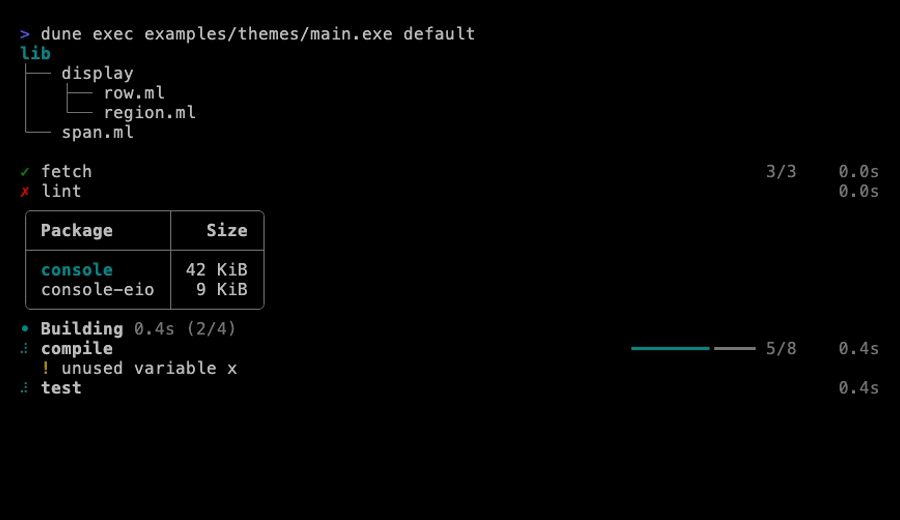

### `Theme.ascii`

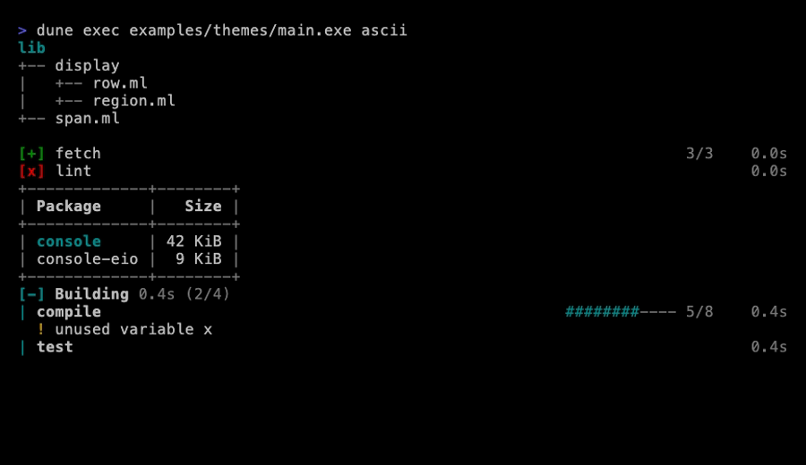

### `Theme.dos`

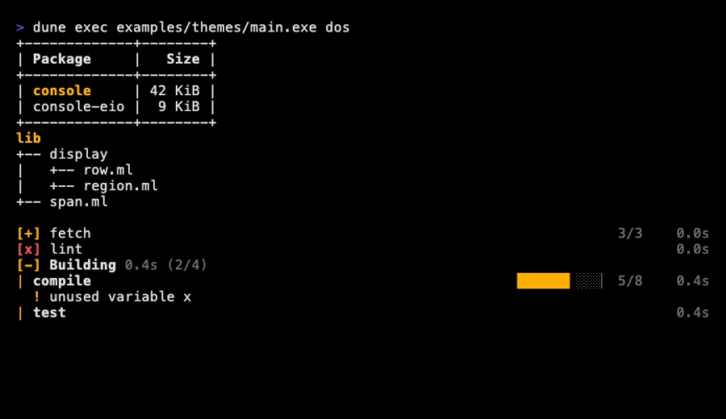

### `Theme.matrix`

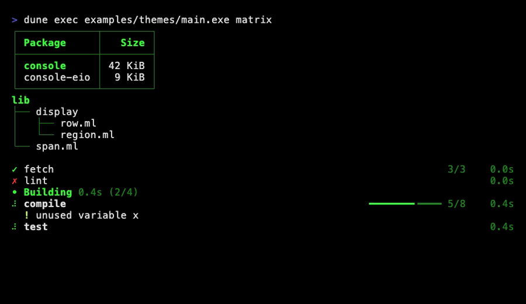

### `Theme.rainbow`

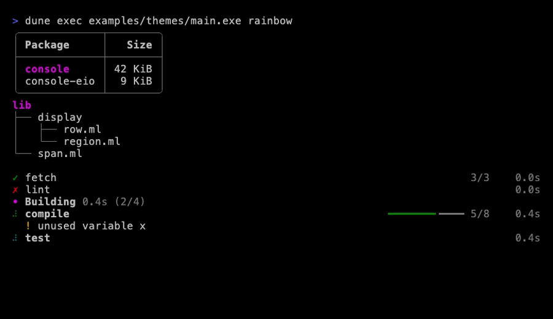

### `Theme.dracula`

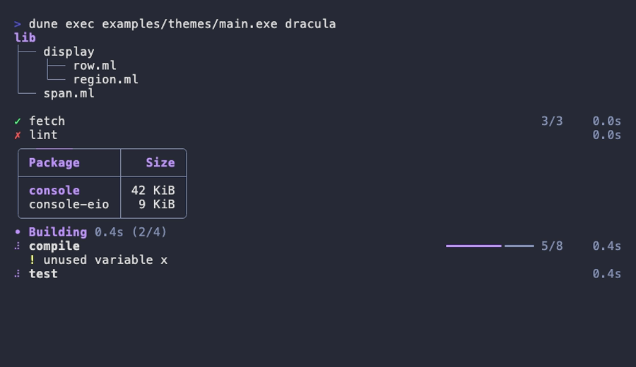

### `Theme.nord`

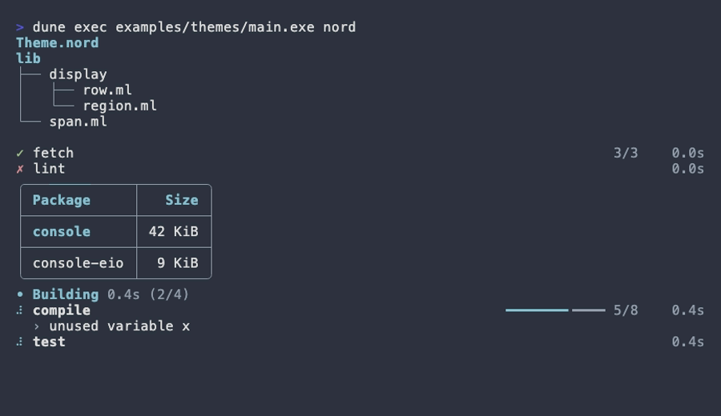

### `Theme.solarized_dark`

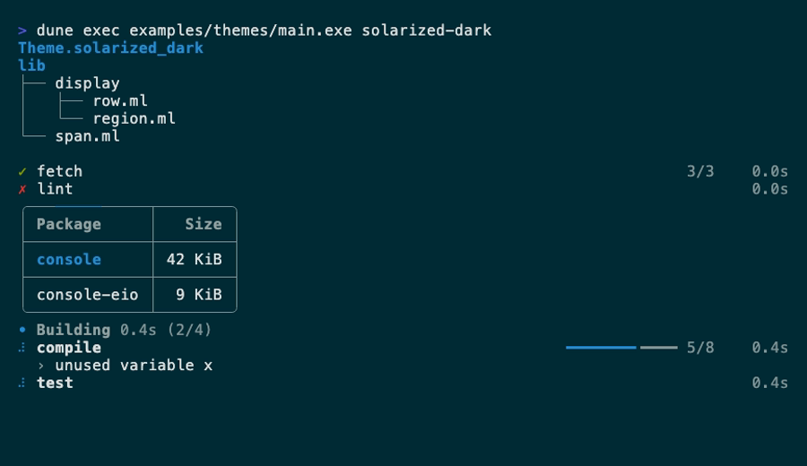

### `Theme.solarized_light`

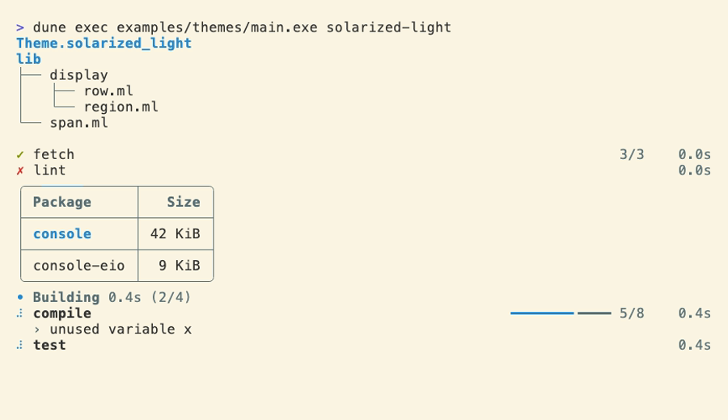

### `Theme.gruvbox_dark`

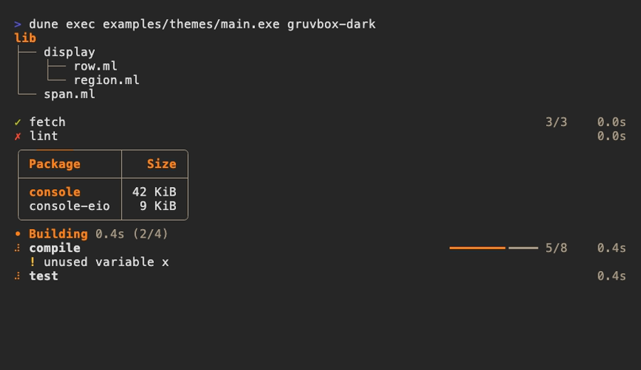

### `Theme.gruvbox_light`

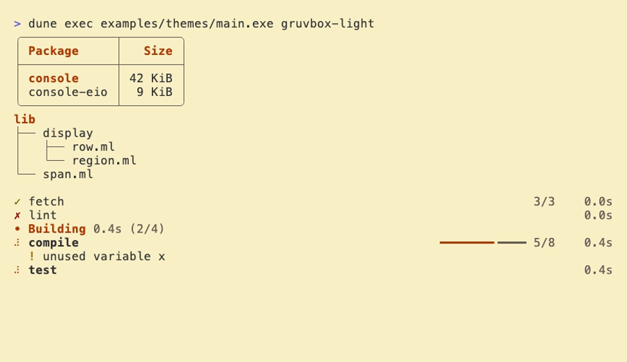

### `Theme.catppuccin_latte`

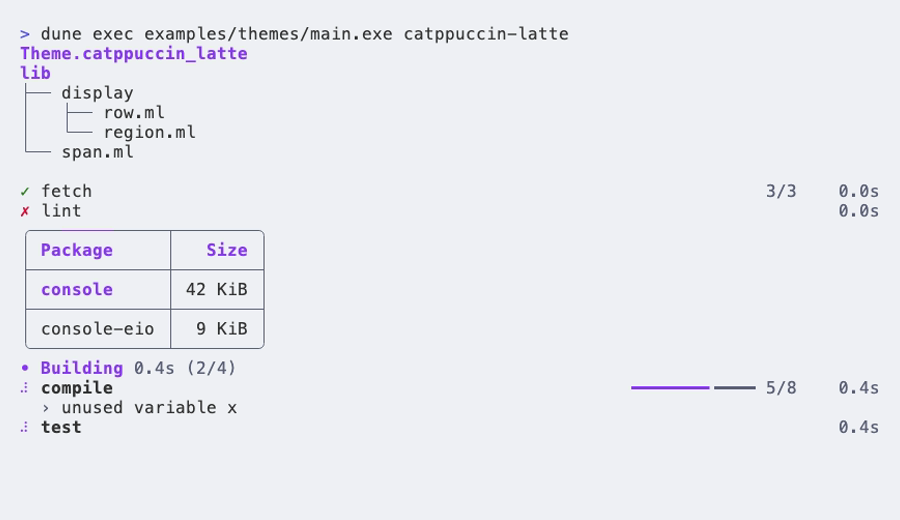

### `Theme.catppuccin_mocha`

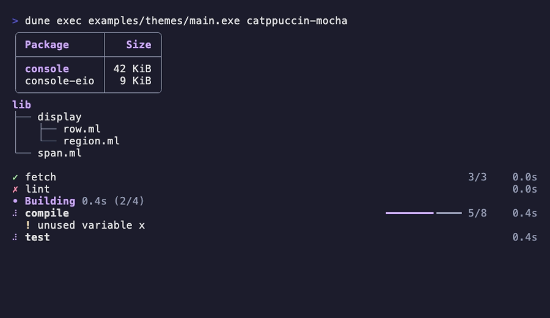

### `Theme.tokyo_night`

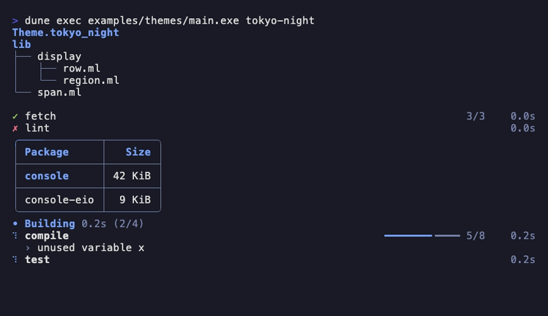

### `Theme.one_dark`

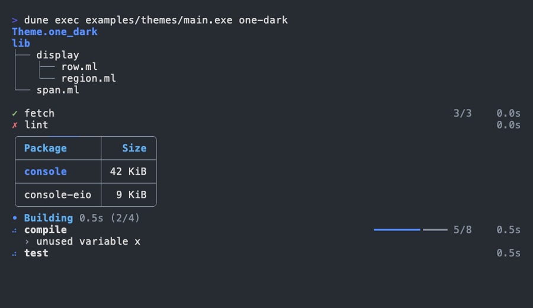

### `Theme.monokai`

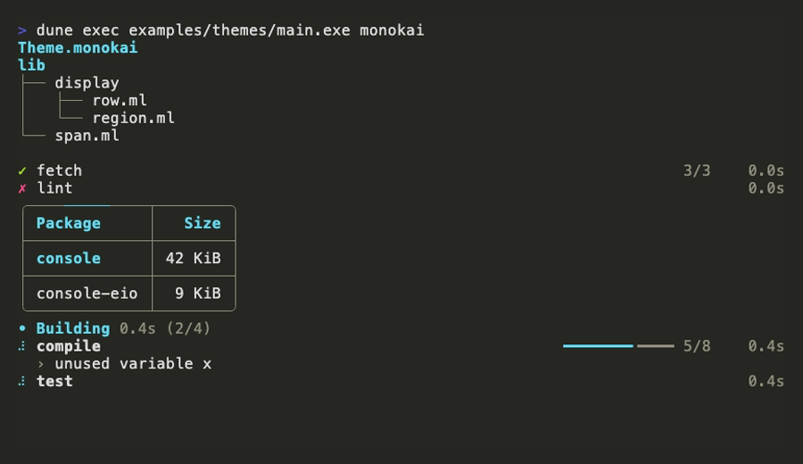

### `Theme.github_dark`

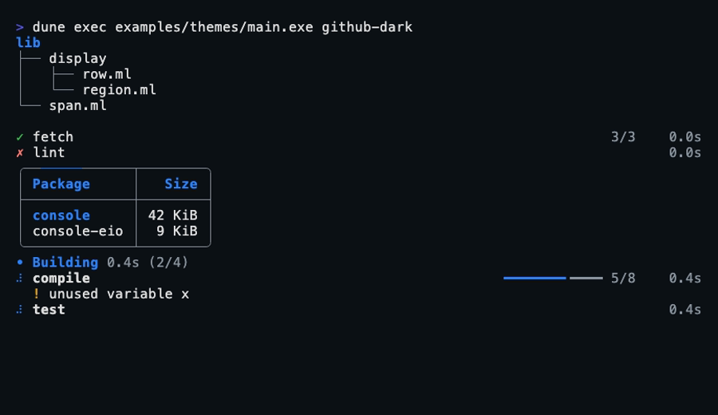

### `Theme.github_light`

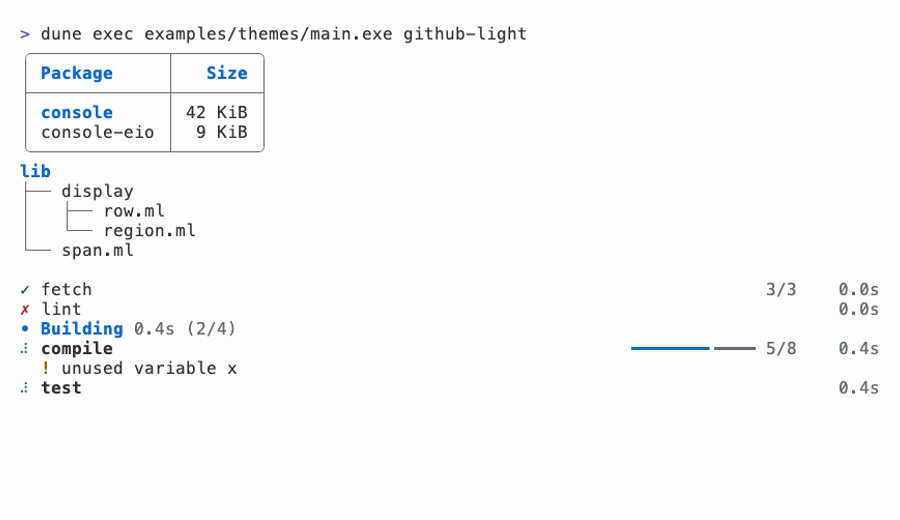
